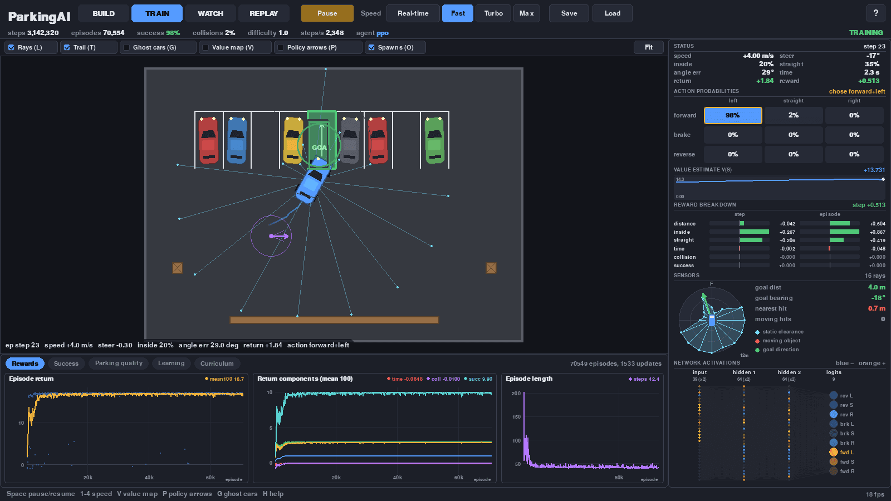
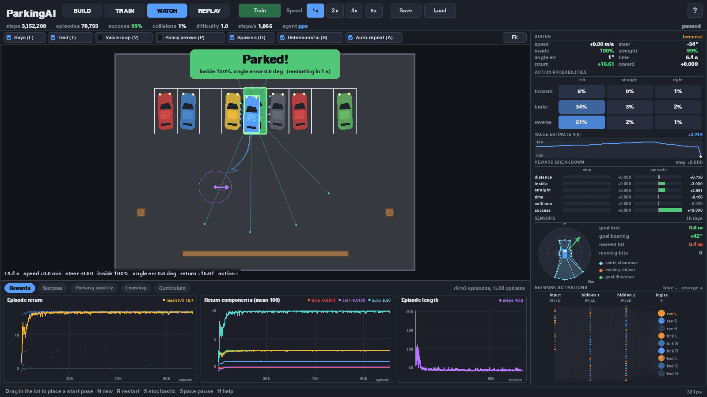
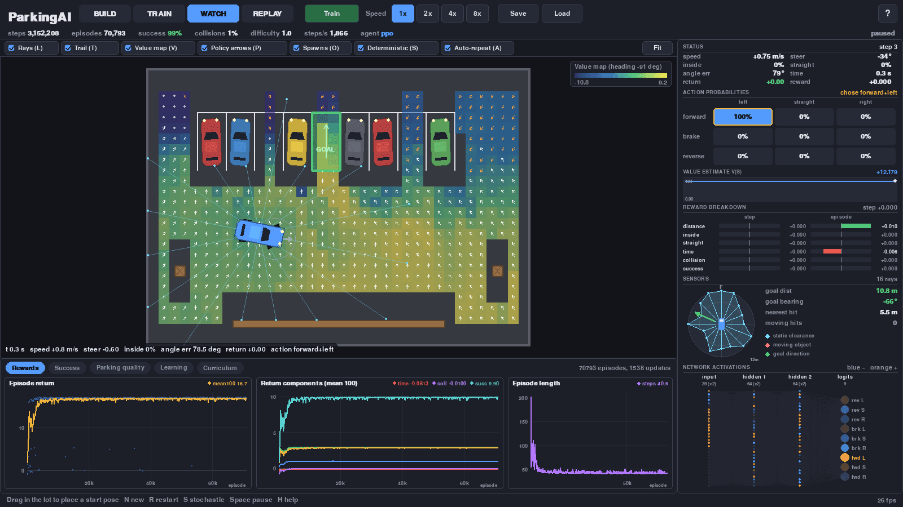
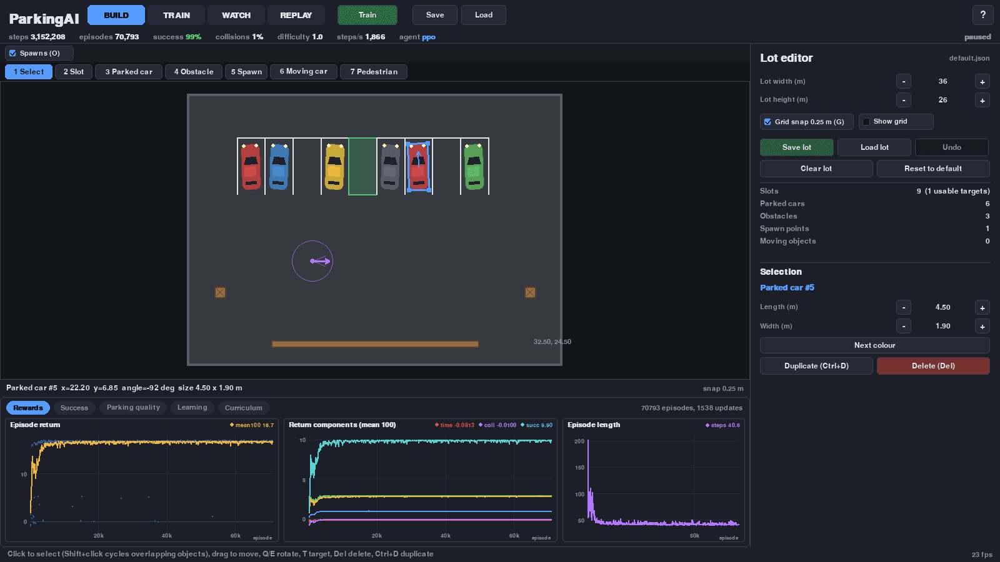
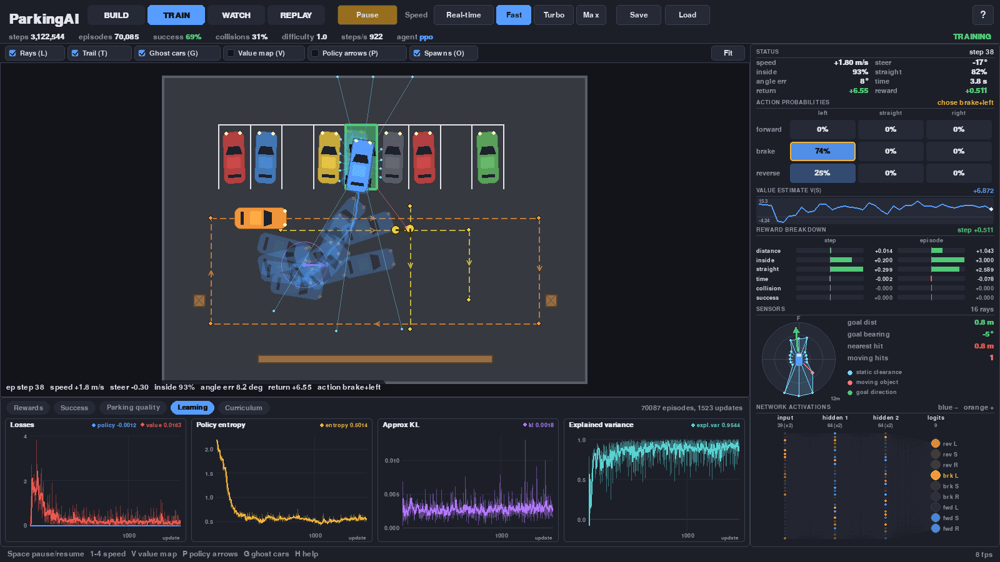

# ParkingAI

A top-down parking lot where a reinforcement-learning agent learns to park a car. You build the lot (slots, parked cars, obstacles, spawn points, moving cars and pedestrians with their own paths) and watch the AI learn. You can see what it senses, which actions it is considering, how it values each situation, how it is rewarded and how its learning curves develop.

## Screenshots


*TRAIN: car 0 of 16 parallel learners heading for the target slot, with the AI inspector on the right and the reward curves at the bottom.*


*WATCH: the trained policy drives on its own and parks (100% inside, 0.8° angle error).*


*Value map (V) and policy arrows (P): how good each spot looks at the current heading, and which way the agent would drive from there.*


*BUILD: the lot editor with its tools (slot, parked car, obstacle, spawn, moving car, pedestrian) and a selected parked car.*


*`busy_lot.json`: a moving car and a pedestrian on their paths, ghost cars (G) showing all learners, and the Learning tab (losses, entropy, KL, explained variance).*

## Run

```bash
python3 run.py
```

You need Python 3.8+, numpy and pygame (`pip install -r requirements.txt`). There is nothing else: the neural network and the PPO algorithm are written in plain numpy.

| Command | What it does |
|---|---|
| `python3 run.py` | Opens the app. Resumes `checkpoints/autosave.pkl` if it exists, otherwise starts an untrained agent on `lots/default.json` |
| `python3 run.py --fresh` | Starts a new untrained agent even if an autosave exists |
| `python3 run.py --load checkpoints/pretrained_default.pkl` | Starts from an agent already trained on the default lot (99% success) |
| `python3 run.py --lot lots/busy_lot.json --fresh` | Trains on another lot (`parallel_parking.json`, `busy_lot.json` with moving traffic) |
| `python3 run.py --headless --minutes 15` | Trains without a window (much faster), then open the result with `python3 run.py` |

The app autosaves to `checkpoints/autosave.pkl` every 2 minutes of training and on quit. **Save** in the top bar writes a separate timestamped checkpoint, and **Load** picks any checkpoint in `checkpoints/`.

## Modes

- **BUILD**: edit the lot. Tools 1-7: Select, Slot, Parked car, Obstacle (drag to size), Spawn (drag sets heading), Moving car, Pedestrian (click waypoints, Enter to finish, C closes the loop, +/- sets speed).
  - Q/E rotate (Shift for 1°). R rotates 90°. T marks a slot as the target. Del deletes. Ctrl+D duplicates. Ctrl+Z undoes. G toggles snap. Ctrl+S saves the lot.
  - When you leave BUILD, training continues on the new lot with the same brain.
- **TRAIN**: 16 cars train in parallel and you see car 0. Space pauses. 1-4 set the speed: Real-time, Fast, Turbo and Max (Max barely redraws and trains the fastest).
- **WATCH**: the current policy drives one car, with no training. Drag in the lot to choose the start position and heading. N gives a new random start, S toggles stochastic or best-action driving, and A toggles auto-repeat.
- **REPLAY**: the last 40 training episodes of car 0, plus the best one so far. Use the timeline scrubber, Space to play, Left/Right to step a frame, and 1-4 for speed.

Everywhere:
- L rays, T trail, G ghost cars (all 16 learners), V value map, P policy arrows, O spawns.
- Wheel to zoom, right-drag to pan, F to fit.
- H shows all shortcuts.

## What you see

- **Lot view**: the car, its 16 lidar rays (red when they hit a moving object), its trail, and a collision or success flash.
  - **Value map** (V) colours every spot of the lot by how good the AI thinks it is to be there at the current heading.
  - **Policy arrows** (P) show what it would do at each spot.
- **AI inspector** (right):
  - Status: inside %, straightness, angle error, speed and return.
  - The 3x3 action-probability grid (forward / brake / reverse x left / straight / right), with the chosen action highlighted.
  - The value estimate V(s) over the episode.
  - The reward breakdown per component, for this step and the whole episode.
  - A radar of the sensor readings with the goal direction.
  - Live neuron activations of the policy network.
- **Charts** (bottom tabs):
  - Rewards: return, return components and episode length.
  - Success: success, collision and timeout rates, plus collisions by kind.
  - Parking quality: final inside % and angle error.
  - Learning: policy and value loss, entropy, KL and explained variance.
  - Curriculum: difficulty and training speed.

## How the AI works

**Car**: a kinematic bicycle model (4.5 m x 1.9 m, 2.7 m wheelbase, steering rate-limited, top speed 4 m/s forward and 2.5 m/s in reverse, 10 Hz).

**Actions**: 9 discrete actions, made of steer (left, straight, right) x throttle (forward, brake, reverse).

**Observation**: 39 numbers.
- The slot position and angle relative to the car.
- Speed and steering.
- The fraction of the car currently inside the slot.
- 16 lidar clearances.
- 16 "this ray sees a moving object" flags.

**Reward**: all weights are in `RewardConfig` in `parkai/env.py`.

| Component | Rule |
|---|---|
| inside | +3 x the change in the fraction of the car inside the slot, so it is paid in proportion to how much of the car gets in (and taken back if it leaves) |
| straight | +3 x the change in (inside x straightness), so being straight only pays once the car is in the slot |
| distance | +2 x the progress toward the slot, which helps it find the slot at all |
| success | +10 when ≥97% is inside, within 6° of straight and stopped. The episode ends |
| time | -0.002 per step |
| collision | wall, obstacle or parked car -1, moving car -10, pedestrian -20. The episode ends |

**Learning**: PPO (clipped policy gradient with GAE). It uses separate 64x64 tanh policy and value networks, running observation normalisation, and Adam.

**Curriculum**: cars first spawn right in front of the slot. Each time the success rate at the current level reaches 70%, the spawn moves 10% closer to your spawn points. On the default lot it reaches full difficulty in about 2 minutes of headless training and about 99% success in about 10 minutes.

## Project layout

```
run.py                 entry point
parkai/world.py        lot model + JSON
parkai/env.py          simulation, sensors, reward (vectorized over parallel cars)
parkai/geometry.py     rectangles, ray casting, paths
parkai/agents/         PPO (ppo.py, nn.py) and a random baseline
parkai/trainer.py      training loop, history, replays, curriculum, checkpoints
parkai/player.py       WATCH mode driver
parkai/ui/             pygame app, lot view, editor, charts and inspector panels
lots/                  example lots
checkpoints/           pretrained_default.pkl + your saves
tests/test_nn.py       gradient check for the numpy network
docs/architecture.md   data contracts and extension points
```

## Moving cars and pedestrians

These already work end to end. You place them in BUILD, they follow their paths (looping or back and forth), they show up in the lidar as "moving", and touching them costs 10 (car) or 20 (pedestrian). For now they follow their path blindly and do not stop for the agent. Smarter behaviour (yielding, random routes, spawning) goes in `ParkingEnv.moving_rects` in `parkai/env.py`. See `docs/architecture.md`.

## Known limitations

- A brain trained on one lot only partly transfers to a very different lot. Expect it to need more training after big edits, especially when moving traffic is added (the pretrained agent drops to about 25% success on `busy_lot.json` until it retrains).
- Training runs on the CPU in the UI thread. Use Turbo or Max, or `--headless`, for speed.
- In REPLAY, the network activations are computed with the current network, while the action probabilities and value are the ones recorded at the time.
